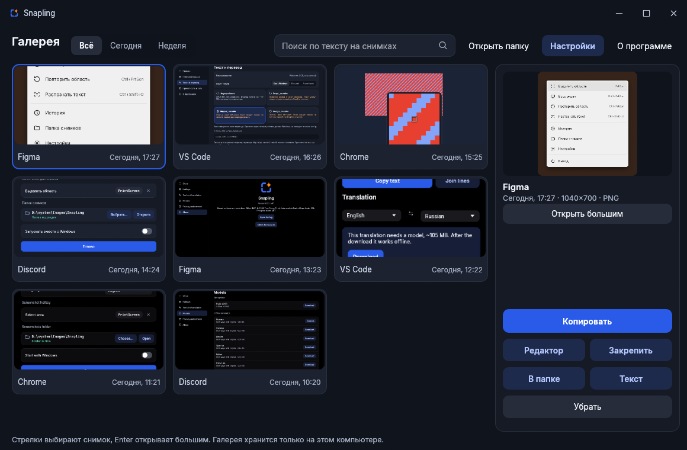
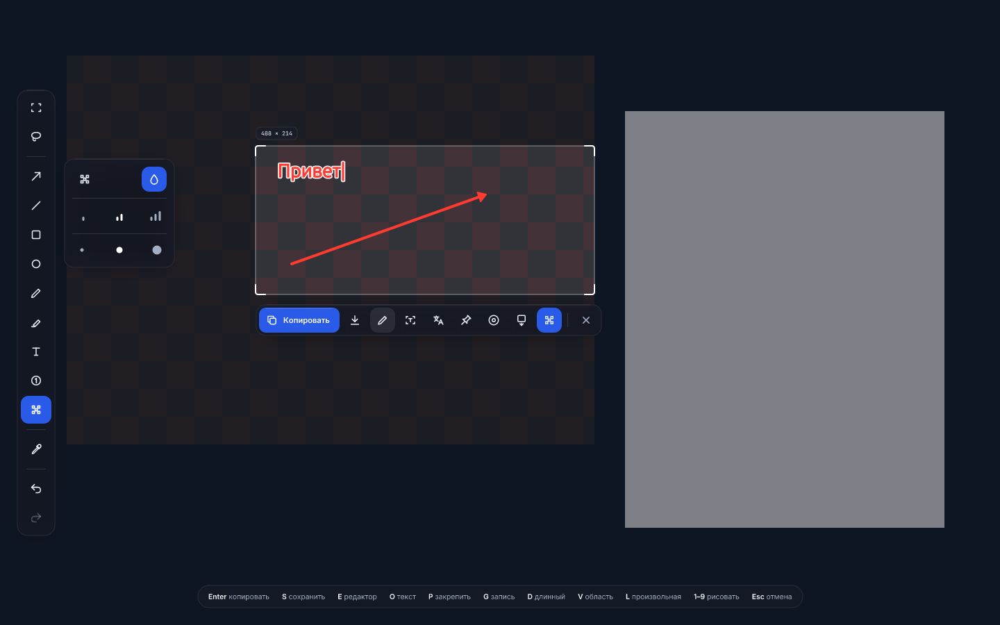
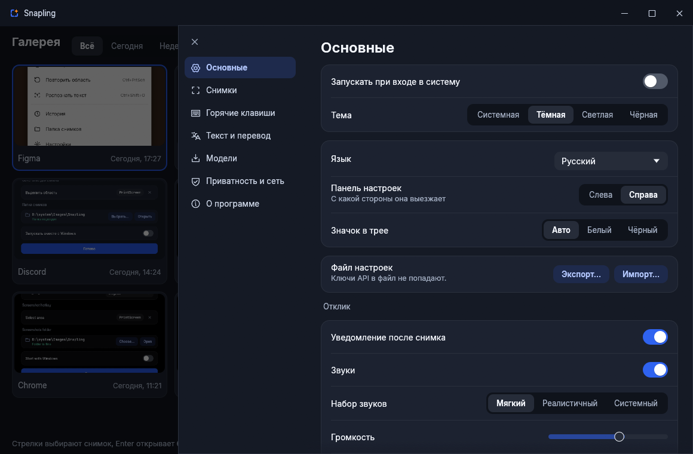

<p align="center">
  
</p>

<h1 align="center">Snapling</h1>

<p align="center">A fast screenshot tool: select, annotate, recognize text, translate, record, stitch long pages. Everything stays on your computer.</p>

<p align="center">
  <a href="https://github.com/MeowKusTrue/Snapling/releases/latest/download/Snapling-Setup.exe"></a>
</p>

<p align="center"><sub>One click downloads <b>Snapling-Setup.exe</b>. Open it and Snapling installs itself, no admin rights needed.<br>
<a href="https://github.com/MeowKusTrue/Snapling/releases/latest/download/Snapling-portable.zip">Portable version (zip)</a> · <a href="https://github.com/MeowKusTrue/Snapling/releases">All versions</a></sub></p>

<p align="center">
  <a href="https://github.com/MeowKusTrue/Snapling/releases/latest"></a>
  <a href="https://github.com/MeowKusTrue/Snapling/releases"></a>
  <a href="LICENSE"></a>
</p>

<p align="center"><a href="README.ru.md">Читать на русском</a></p>



## Features

- **Selection:** an area, a window, an element inside a window or the whole screen. Freeform outline, drag handles, arrow keys, and a magnifier at the cursor.
- **Annotation right on the screen:** arrows, lines, shapes, pen, marker, text, numbered steps and a blur brush, before or after you select.
- **Color picker:** click to copy a color as HEX, RGB, HSL, HSV or CMYK.
- **Text:** recognition without internet, with small text enlarged first. Windows OCR or PaddleOCR.
- **Translation:** 14 languages. Offline with OPUS-MT, or through DeepL, Yandex and Google with your own key, sent only when you press the button.
- **Screen recording:** GIF or MP4, no sound, a countdown and cancel. The frame and timer never get into the file.
- **Long screenshots:** scrolls the page by itself and stitches it, sticky headers stay single.
- **Pin:** keep a shot on top of all windows, zoom it with the wheel.
- **Gallery:** every shot in one window, search by the text on them, a large view, and recognition of old shots.
- **Editor:** the same tools with undo, zoom, moving shapes and saving as PNG, WebP or JPEG.
- **Settings:** hotkeys pressed right on the keyboard with conflict search, four themes including pure black, three sound sets or your own sounds, a proxy, settings import and export.
- **Languages:** English and Russian. A new language is one TOML file.

| | |
|---|---|
|  |  |

## Privacy

Snapling goes online only when you ask it to: downloading a model, online translation, and checking for updates. API keys stay in the system keyring, never in files or logs.

## Install

### Windows

**[Download Snapling-Setup.exe](https://github.com/MeowKusTrue/Snapling/releases/latest/download/Snapling-Setup.exe)** and open it. It asks for a folder and needs no admin rights.

| File | Who needs it |
|---|---|
| `Snapling-Setup.exe` | Everyone. Installs for the current user. |
| `Snapling-portable.zip` | If you want Snapling in a folder of your choice. Settings stay next to it. |

Requires Windows 10 2004 or newer, x64. To free the PrtScn key from the Snipping Tool, press **Fix** on the welcome screen.

### Arch, CachyOS

```bash
cd packaging/aur
makepkg -si
```

Linux support is early. It needs `grim`, `wl-clipboard` and `pipewire`. Optional: `wf-recorder` and `ffmpeg` for recording, `wlrctl` for long screenshots, `libnotify`, `libsecret`, `zenity`.

Wayland gives apps no global hotkeys, so bind them in `hyprland.conf`:

```
exec-once = snapling
bind = , Print, exec, snapling --region
bind = SHIFT, Print, exec, snapling --screen
bind = CTRL, Print, exec, snapling --record
bind = CTRL SHIFT, Print, exec, snapling --long
bind = SUPER SHIFT, O, exec, snapling --ocr

windowrulev2 = fullscreen, title:^(Snapling)$
windowrulev2 = noanim, title:^(Snapling)$
windowrulev2 = float, title:^(Snapling pin)$
windowrulev2 = pin, title:^(Snapling pin)$
```

`snapling --record` a second time stops the recording, `snapling --record-cancel` drops it. On X11 use the same flags with `xclip` and `ffmpeg`.

### macOS

Early: capture, selection and windows, without a tray, recording or long screenshots. Build from source.

## Build

You need [Rust](https://rustup.rs). The Windows installer also needs [Inno Setup 6](https://jrsoftware.org/isdl.php).

```bash
cargo run                  # run from source
cargo test --workspace     # tests
python tools/package.py    # target/dist: installer and portable zip
```

Pushing a tag like `v1.0.0` builds a release through `.github/workflows/release.yml`.

## Translations

Each language is one file in [`assets/i18n`](assets/i18n). Copy `en.toml`, change `_name` and translate the right side. Run `python tools/i18n_sync.py` after adding strings. You can also drop a file into the `i18n` folder next to the settings, without rebuilding.

## Credits

Built on ideas and code from [EiSen](https://github.com/thucne/EiSen). Libraries, fonts, models and sounds are listed in [THIRD_PARTY_NOTICES.md](THIRD_PARTY_NOTICES.md).

## License

[MIT](LICENSE)
