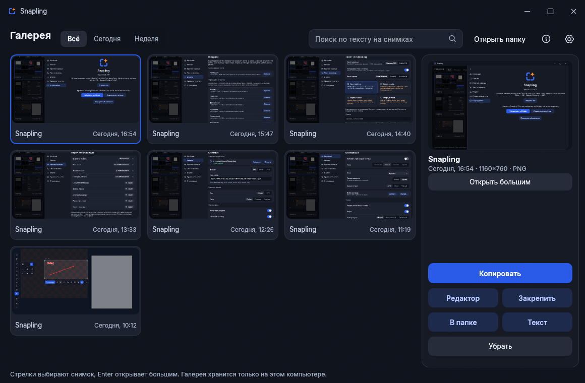
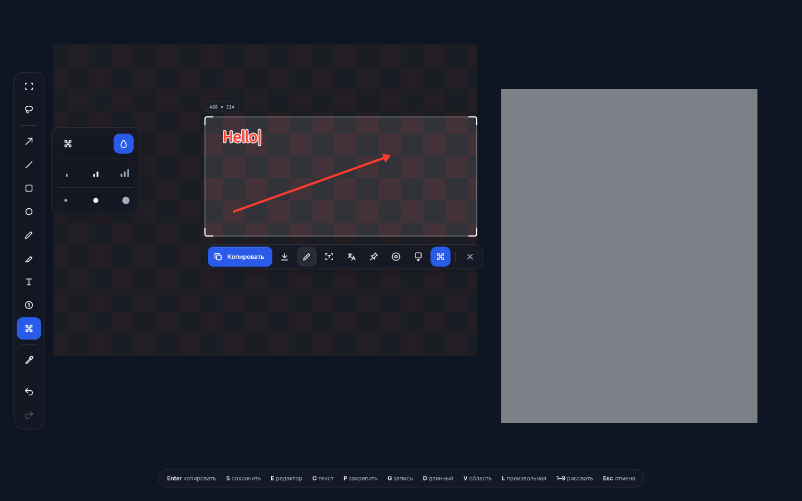
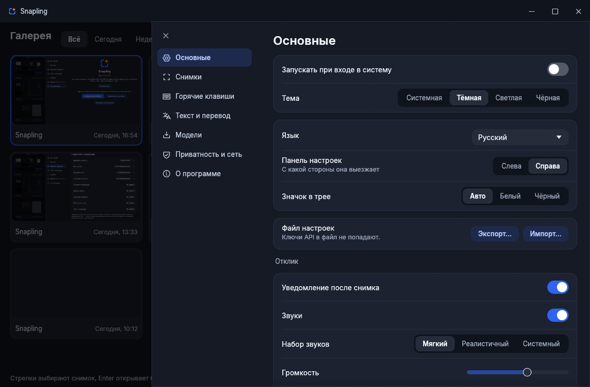

<p align="center">
  
</p>

<h1 align="center">Snapling</h1>

<p align="center">Быстрые скриншоты: выделение, пометки, распознавание текста, перевод, запись экрана, длинные страницы. Всё остаётся на твоём компьютере.</p>

<p align="center">
  <a href="https://github.com/MeowKusTrue/Snapling/releases/latest/download/Snapling-Setup.exe"></a>
</p>

<p align="center"><sub>Один клик скачивает <b>Snapling-Setup.exe</b>. Открой его, и Snapling установится сам, права администратора не нужны.<br>
<a href="https://github.com/MeowKusTrue/Snapling/releases/latest/download/Snapling-portable.zip">Портативная версия (zip)</a> · <a href="https://github.com/MeowKusTrue/Snapling/releases">Все версии</a></sub></p>

<p align="center">
  <a href="https://github.com/MeowKusTrue/Snapling/releases/latest"></a>
  <a href="https://github.com/MeowKusTrue/Snapling/releases"></a>
  <a href="LICENSE"></a>
</p>

<p align="center"><a href="README.md">Read in English</a></p>



## Возможности

- **Выделение:** область, окно, элемент внутри окна или весь экран. Произвольный контур, ручки, стрелки на клавиатуре и лупа у курсора.
- **Пометки прямо на экране:** стрелки, линии, фигуры, перо, маркер, текст, нумерация и кисть размытия, до выделения и после него.
- **Пипетка:** клик копирует цвет в HEX, RGB, HSL, HSV или CMYK.
- **Текст:** распознавание без интернета, мелкий текст сначала увеличивается. Windows OCR или PaddleOCR.
- **Перевод:** 14 языков. Без интернета через OPUS-MT или через DeepL, Яндекс и Google со своим ключом, текст уходит только по кнопке.
- **Запись экрана:** GIF или MP4, без звука, с отсчётом и отменой. Рамка и таймер в файл не попадают.
- **Длинный скриншот:** сам крутит страницу и склеивает её, закреплённая шапка не повторяется.
- **Закрепление:** снимок поверх всех окон, колесо меняет размер.
- **Галерея:** все снимки в одном окне, поиск по тексту на них, большой просмотр и распознавание старых снимков.
- **Редактор:** те же инструменты, плюс отмена, масштаб, перемещение фигур и сохранение в PNG, WebP и JPEG.
- **Настройки:** сочетания нажимаются прямо на клавиатуре с поиском конфликтов, четыре темы и чистый чёрный среди них, три набора звуков или свои, прокси, импорт и экспорт настроек.
- **Языки:** английский и русский. Новый язык — это один файл TOML.

| | |
|---|---|
|  |  |

## Приватность

Snapling выходит в сеть только по твоей просьбе: скачивание модели, онлайн-перевод и проверка обновлений. Ключи API хранятся в системном хранилище, а не в файлах и логах.

## Установка

### Windows

**[Скачай Snapling-Setup.exe](https://github.com/MeowKusTrue/Snapling/releases/latest/download/Snapling-Setup.exe)** и открой его. Он спросит папку, права администратора не нужны.

| Файл | Кому нужен |
|---|---|
| `Snapling-Setup.exe` | Всем. Ставит программу для текущего пользователя. |
| `Snapling-portable.zip` | Если нужна своя папка. Настройки лежат рядом с программой. |

Нужна Windows 10 2004 или новее, x64. Чтобы забрать клавишу PrtScn у «Ножниц», нажми **Исправить** на экране приветствия.

### Arch, CachyOS

```bash
cd packaging/aur
makepkg -si
```

Поддержка Linux ранняя. Нужны `grim`, `wl-clipboard` и `pipewire`. По желанию: `wf-recorder` и `ffmpeg` для записи, `wlrctl` для длинных скриншотов, `libnotify`, `libsecret`, `zenity`.

В Wayland у программ нет глобальных сочетаний, поэтому они задаются в `hyprland.conf`:

```
exec-once = snapling
bind = , Print, exec, snapling --region
bind = SHIFT, Print, exec, snapling --screen
bind = CTRL, Print, exec, snapling --record
bind = CTRL SHIFT, Print, exec, snapling --long
bind = SUPER SHIFT, O, exec, snapling --ocr

windowrulev2 = fullscreen, title:^(Snapling)$
windowrulev2 = noanim, title:^(Snapling)$
windowrulev2 = float, title:^(Snapling pin)$
windowrulev2 = pin, title:^(Snapling pin)$
```

Второй вызов `snapling --record` останавливает запись, `snapling --record-cancel` отменяет её. На X11 те же флаги, нужны `xclip` и `ffmpeg`.

### macOS

Ранняя версия: захват, выделение и окна, без трея, записи и длинных скриншотов. Сборка из исходников.

## Сборка

Нужен [Rust](https://rustup.rs). Для установщика Windows ещё [Inno Setup 6](https://jrsoftware.org/isdl.php).

```bash
cargo run                  # запуск из исходников
cargo test --workspace     # тесты
python tools/package.py    # target/dist: установщик и portable
```

Тег вида `v1.0.0` собирает выпуск через `.github/workflows/release.yml`.

## Переводы

Каждый язык — один файл в [`assets/i18n`](assets/i18n). Скопируй `en.toml`, поменяй `_name` и переведи правую часть. После новых строк запусти `python tools/i18n_sync.py`. Файл можно положить и в папку `i18n` рядом с настройками, без пересборки.

## Благодарности

Основано на идеях и коде [EiSen](https://github.com/thucne/EiSen). Библиотеки, шрифты, модели и звуки перечислены в [THIRD_PARTY_NOTICES.md](THIRD_PARTY_NOTICES.md).

## Лицензия

[MIT](LICENSE)
